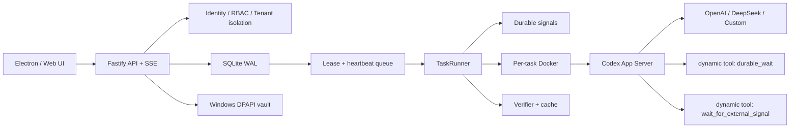
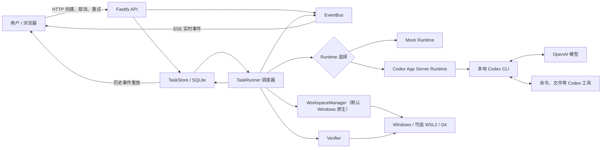
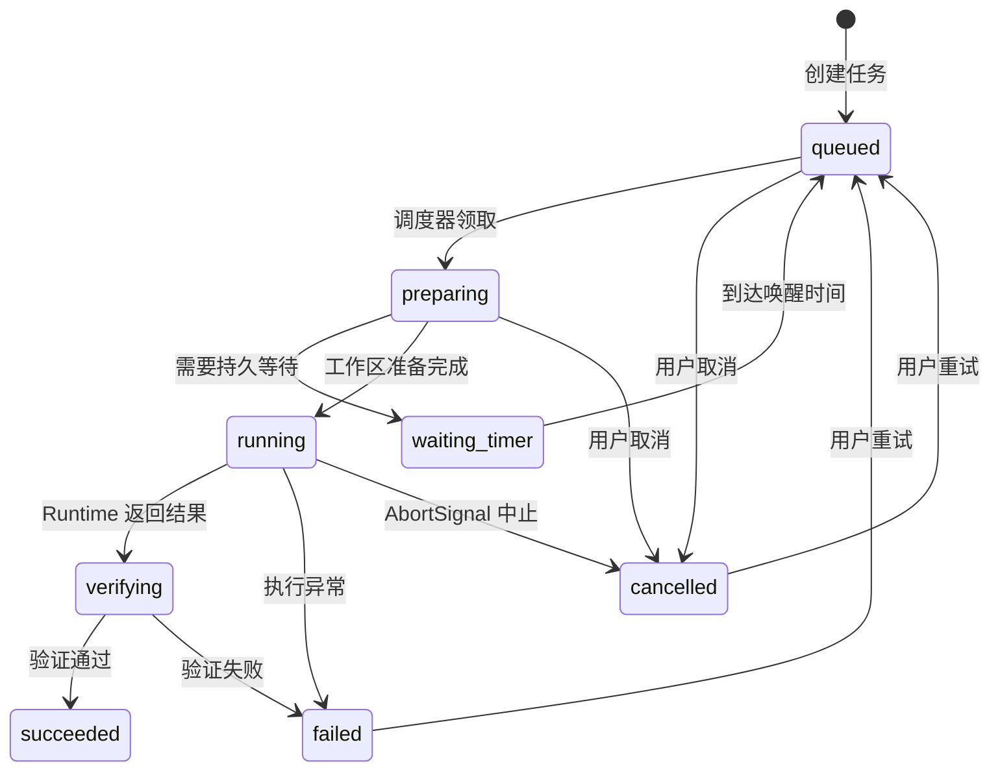
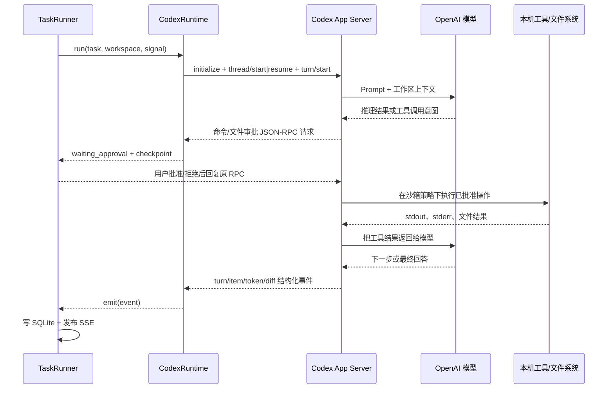

# Agent Foundry Local 架构分析

> 本文面向完全没有 Agent 开发经验的读者，并以当前目录中的实际代码为准。
>
> 当前项目是“本机单用户优先、预留多租户部署”的 P1/P2 实现：可靠调度、完整审批、Docker 沙箱、分层 Memory、多 Agent、RBAC/审计/配额和 Windows 加密密钥库已经接入。

## 0. 2026-08-13 P1/P2 架构更新



新增文件/目录职责：

- `server/sandbox/docker-sandbox.ts`：构建/复用沙箱镜像，创建每任务容器，挂载工作区、附件、Codex Home、额外 roots 和 Skills，限制资源并回收。
- `server/security/identity.ts`：本机 owner 模式、Bearer token 模式、tenant/user/role 与 RBAC。
- `server/security/secret-vault.ts`：Windows DPAPI Provider key 加密库。
- `server/runtime/codex-control.ts`：模型能力、Skills、MCP、权限、thread 控制和 review API；MCP OAuth 使用有生命周期的独立 App Server，会保存操作状态直到浏览器回调完成或超时，应用关闭时统一回收。当前 bundled Codex 不再提供协作模式目录，平台不会调用不存在的兼容端点。
- `server/runtime/plugin-manager.ts`：通过 bundled Codex CLI 的 JSON 协议管理插件目录、安装状态与本地/Git 市场，复用隔离的 `CODEX_HOME`，不解析面向人的终端文本。
- `server/workflow/multi-agent.ts`：子任务、Git worktree、child signal、handoff 与合并。
- `server/core/settings.ts`：平台设置持久化、热应用和数据库 migration 状态。
- `server/core/approval-notifier.ts`：审批 Webhook 通知、幂等记录与通知事件。
- `desktop/support-bundle.ts`：生成可发送给开发者的脱敏问题反馈资料，导出对话、事件、审批、环境摘要和日志，但不复制密钥、数据库、附件正文或工作区正文。
- `tests/docker-sandbox-smoke.ts`：真实容器读写与回收测试。

当前完整工具调用流程：

1. UI 打开新对话时先恢复可用的加密草稿；输入防抖 350ms 后，经受限 preload IPC 交给 Electron `safeStorage` 使用 Windows DPAPI 加密，保存到数据目录 `ui/pending-conversation-draft.bin`。正式对话的未发送追问与附件则按任务 ID 独立保存在 `ui/pending-follow-up-drafts.bin`，切换、重载或重启后只恢复到原对话，最多保留最近 100 个非空草稿。显式丢弃或发送成功才清空对应草稿。系统加密不可用时只保留内存，绝不降级为明文。首次发送后才通过 API 创建正式任务。继续对话时直接复用已有任务；API 做身份、租户、Provider capability 和配额校验。
2. TaskStore 在 SQLite 中持久化任务、消息、Memory 和事件。
3. Worker 按优先级及租户/Provider 并发领取任务，写 lease 并 heartbeat。
4. Workspace Manager 默认在 Windows 原生目录准备 Git 工作区；仅在用户主动启用时进入 WSL2 或由 Docker Manager 创建/恢复任务容器。
5. 容器内 App Server 启动，Runner 注入 workspace roots、Skills、`durable_wait` 和 `wait_for_external_signal`。
6. Codex 命令/文件/用户输入请求经 JSON-RPC 返回平台，写 Approval 和 durable signal。
7. 工具事件和 App Server 的公开推理摘要标准化为 AgentEvent，经 SSE 实时显示并持久化；私有原始 reasoning delta 不进入 UI 和数据库。
8. `durable_wait` 或外部信号等待会释放 Worker；定时到期/webhook 到达后恢复原 RPC，或跨重启在同一 thread 根据 checkpoint 重查。
9. Verifier 执行仓库策略，使用内容指纹缓存和 flaky 重跑；失败最多自动修复两轮。
10. 只有验证通过才写入最终消息、分层 Memory、usage/artifact 并标记 succeeded。

## 1. 先理解 Agent 到底是什么

普通聊天程序大致是：

```text
用户问题 → 大模型生成文字 → 返回文字
```

Agent 多了一层“行动能力”：

```text
用户目标 → 大模型思考下一步 → 调用工具 → 读取工具结果
        → 再思考 → 再调用工具 → 验证结果 → 返回最终答案
```

例如，用户要求“修复项目中的一个错误”，Agent 可能依次：

1. 查看目录。
2. 读取源代码。
3. 搜索错误位置。
4. 修改文件。
5. 执行测试。
6. 如果测试失败，再次修改。
7. 测试通过后给出结果。

其中大模型负责“决定下一步做什么”，工具负责“真的在计算机上做事”。

### 1.1 本项目中的核心名词

| 名词 | 通俗解释 | 本项目中的实现 |
| --- | --- | --- |
| Model / 模型 | 负责理解、推理和决策的大脑 | OpenAI 模型；DeepSeek `deepseek-v4-flash` |
| Tool / 工具 | 模型可以使用的手和眼睛，如读文件、写文件、执行命令 | 真实任务由 Codex CLI 内部提供和执行 |
| Runtime / 运行时 | 把模型、工具、上下文组织起来并执行一次 Agent 任务 | `MockRuntime`、`CodexRuntime` |
| Runner / 调度执行器 | 决定哪个任务何时运行，并包住 Runtime | `TaskRunner` |
| Workspace / 工作区 | Agent 可以查看和修改的项目目录 | `.agent-data/workspaces/<任务ID>` 或用户指定目录 |
| State Machine / 状态机 | 规定任务可以从哪个状态进入哪个状态 | `state-machine.ts` |
| Persistence / 持久化 | 服务重启后任务仍然存在 | SQLite 数据库 |
| Event / 事件 | 执行过程中发生的一条事实记录 | `task_events` 表和 SSE 实时流 |
| Checkpoint / 检查点 | 记录任务已经执行到哪一步 | `checkpoint_json` |
| Sandbox / 沙箱 | 限制 Agent 可以访问和修改的范围 | 默认 Windows 原生 Codex 沙箱 + `workspace-write`；Docker 与 WSL2 为可选后端 |
| Verification / 验证闭环 | Agent 说完成后，平台再独立检查一次 | 默认在 Windows 原生工作区运行类型、测试、构建、Git 与自定义检查，也可路由到 Docker/WSL2 |

## 2. 整体架构



最重要的分层是：

```text
Web UI
  ↓
HTTP API
  ↓
持久化任务调度器
  ↓
可替换的 Agent Runtime
  ↓
模型和工具
```

因此，将来更换模型时，理想情况是新增一个 Runtime 或 Provider Adapter，而不是重写状态机、数据库和 UI。

## 3. 任务状态机

主成功路径如下：



当前代码还定义了一个未来状态，并已完整启用审批状态：

- `waiting_external`：等待 webhook、第三方任务、人工上传文件等外部事件。
- `waiting_approval`：命令或文件请求进入 Tool Gateway 后，Runner 在此状态持久化 checkpoint；UI 批准或拒绝后重新排队并续跑。

## 4. 完整的任务与工具调用流程

这里把“平台调用”和“模型工具调用”分开讲。它们经常都被叫作调用，但不是同一件事。

### 4.1 服务启动流程

1. 执行 `npm run dev`。
2. `concurrently` 同时启动 Web 进程和 API 进程。
3. `server/index.ts` 依次读取 `.env.local`、`.env`。
4. `loadConfig()` 把环境变量转换成统一的 `AppConfig`。
5. `TaskStore` 打开 `.agent-data/agent-platform.db`，开启 SQLite WAL 模式并自动建表。
6. `recoverInterruptedTasks()` 查找上次进程退出时处于 `preparing`、`running`、`verifying` 的任务，把它们重新放回 `queued`。
   恢复结果区分 `queued` 与 `failed`：超过尝试上限的任务进入死信并生成失败事件，界面不会再误报“已恢复”。租约过期恢复遵循相同结果模型。`waiting_retry` 保留下一次执行时间，用户可选择立即入队或停止；立即入队不重置剩余自动重试预算。
7. `TaskRunner.start()` 开启每 500 毫秒一次的轻量调度循环。
8. Fastify 只监听 `127.0.0.1:8788`。
9. Web 开发服务器通常监听 `localhost:3000`。

### 4.2 用户创建任务

1. 用户在 `AgentConsole.tsx` 中填写标题、目标、Runtime、Provider、模型和工作区。
2. 浏览器发送：

   ```http
   POST /api/tasks
   Content-Type: application/json
   ```

3. Fastify 收到请求。
4. Zod 校验标题、Prompt、运行时、模型和等待时间，阻止错误或超长输入。
5. API 检查 Runtime 与 Provider 是否兼容：
   - `mock` 不需要密钥。
   - `codex + openai` 需要 `OPENAI_API_KEY`。
   - `codex + deepseek` 需要 `DEEPSEEK_API_KEY`，模型必须使用当前支持 Responses API 的 `deepseek-v4-flash`。
   - `codex + custom` 只有在 `MODEL_WIRE_API=responses` 且提供了 Key 时才允许。
6. `TaskStore.createTask()` 向 `tasks` 表写入一条 `queued` 任务。
7. 同时向 `task_events` 表写入 `task.created`。
8. API 返回任务 ID，UI 自动选中新任务。

### 4.3 调度器领取任务

`TaskRunner` 每 500 毫秒执行一次 `tick()`：

1. 先执行 `wakeDueTasks()`，唤醒已经到期的 `waiting_timer` 任务。
2. 如果当前已有任务执行，则本轮退出。当前 MVP 一次只运行一个任务。
3. `claimNextTask()` 开启 SQLite `BEGIN IMMEDIATE` 事务。
4. 找到最早的一条 `queued` 任务。
5. 原子地把它改为 `preparing`，避免同一个任务被重复领取。
6. 调用 `execute(task)`。

### 4.4 准备 Windows 原生或可选 WSL2 工作区

1. `WorkspaceManager.prepare()` 决定目录：
   - 用户指定了目录：使用该目录。
   - 没有指定：创建 `.agent-data/workspaces/<task-id>`。
2. 默认 `native` 模式直接保留 Windows 绝对路径；只有主动选择 `wsl2` 时才转换路径，例如：

   ```text
   E:\自研agent\demo
   ↓
   /mnt/e/自研agent/demo
   ```

3. 如果目录里没有 `.git`，默认直接调用 Windows Git：

   ```powershell
   git init --quiet
   ```

   可选 WSL2 模式才通过 `wsl.exe` 执行；可选 Docker 模式把同一 Windows 工作区挂载进任务容器。

4. 工作区信息写回任务，并产生 `workspace.ready` 事件。

### 4.5 持久等待流程

如果任务设置了 `waitSeconds`，第一次执行不会调用 `sleep`：

1. 计算 `nextWakeupAt`。
2. 把状态改为 `waiting_timer`。
3. 写入 `checkpoint = { phase: "timer_elapsed" }`。
4. 将 `nextWakeupAt` 和 checkpoint 提交到 SQLite。
5. 当前 `execute()` 直接返回，内存中不保留长时间 Promise，也不占用模型连接。
6. 即使 API 被关闭，等待数据仍在数据库中。
7. API 重启后，调度器看到时间已到，将任务改回 `queued`。
8. 第二次执行发现 checkpoint 已存在，因此跳过等待，进入 Runtime。

这就是长任务应该使用的模式：

```text
保存状态 → 释放进程资源 → 由事件或时间重新唤醒
```

而不是：

```text
启动一个 shell → sleep 6 小时 → 祈祷进程一直不退出
```

### 4.6 Runtime 选择

`TaskRunner` 根据 `task.runtime` 从注册表选择：

```ts
{
  mock: new MockRuntime(),
  codex: new CodexRuntime(config)
}
```

两个 Runtime 都实现同一个 `AgentRuntime` 接口，所以调度器不需要知道其内部细节。

### 4.7 Mock Runtime 的调用流程

Mock Runtime 不调用模型，主要用于测试平台本身：

1. 发出 `agent.plan`。
2. 等待很短时间模拟执行。
3. 发出 `tool.started`，模拟 `git status --short`。
4. 发出 `tool.completed`。
5. 发出 `agent.message`。
6. 返回固定格式的最终结果。

它验证的是队列、状态、事件、UI、取消和验证闭环，而不是模型能力。

### 4.8 真实 Codex Runtime 与模型工具调用

真实任务的完整链路是：



逐步说明：

1. `CodexRuntime` 从 Provider 配置中读取 API Key、Base URL 和默认模型。
2. 启动打包内 `codex app-server --stdio`，通过 JSON-RPC 完成 `initialize`。
3. 如果任务没有 `threadId`，调用 `thread/start`；有 `threadId` 则调用 `thread/resume`，然后调用 `turn/start`。
4. 给线程设置：
   - 工作目录：任务的 Windows 工作区路径。
   - 沙箱：默认 `workspace-write`。
   - 网络：默认关闭。
   - Web 搜索：关闭。
   - 审批：默认 `on-request`，敏感命令与文件写入进入平台审批。
5. App Server 启动一轮 Agent 执行。
6. App Server 负责和模型通信、管理上下文、执行工具，并把双向请求交给平台。
7. 模型可能返回“需要调用工具”的决定，Codex CLI 执行对应操作，再把结果喂回模型。
8. 这一循环可以发生多次，直到模型产生最终回答或执行失败。
9. App Server 把 `thread/started`、`item/started`、`item/completed`、`turn/completed`、Token 和 diff 等事件流式交给 `CodexRuntime`。
10. `CodexRuntime` 把每个事件交给 `TaskRunner.emit()`。
11. `emit()` 先把事件永久写入 SQLite，再通过内存 EventBus 推送给在线浏览器。
12. 遇到完成的 `agent_message` 时，Runtime 记录最终文本。
13. `threadId` 会写入任务，供后续恢复同一 Codex 会话。

平台自己的 Tool Gateway 管理 Codex 的命令/文件审批、Git 变更按钮和兼容旧版的一次性终端命令。右侧新终端由 Terminal Manager 管理，因为用户是在终端中直接操作，不再对自己键入的每条命令重复弹审批；它仍强制套用当前任务的沙箱档位。在线审批会回复原 JSON-RPC，从原步骤继续；应用在审批期间重启时，checkpoint 会保存决定，并让同一 Codex Thread 检查当前工作区后重新规划，避免盲目重复副作用。

### 4.9 验证闭环

Runtime 返回结果并不代表任务立刻成功：

1. 状态先从 `running` 变为 `verifying`。
2. 写入 `verification.started`。
3. `Verifier` 识别 `package.json`、`pyproject.toml` / `requirements.txt`、`Cargo.toml`。
4. 按项目执行语法/类型、Lint、单测、构建、`git diff --check` 和 `git status --short`。
5. 每项检查记录命令、状态、退出码、耗时和日志。
6. 必要检查失败时，将结构化失败回送原 Runtime，最多进行两轮自动修复。
7. 全部通过后才进入 `succeeded`；两轮仍失败则进入 `failed`。

### 4.10 UI 如何实时看到事件

1. UI 先请求 `GET /api/tasks/:id`，取得任务和历史事件。
2. 然后建立 `EventSource` 连接：

   ```http
   GET /api/tasks/:id/stream
   ```

3. API 先从 SQLite 重放已有事件。
4. API 再订阅内存中的 `EventBus`，接收新事件。
5. 每个新事件通过 SSE 发送给浏览器。
6. 每 15 秒发送一次 heartbeat，保持连接。
7. 单对话 SSE 负责实时详情；全局任务活动 SSE 负责并行任务的列表状态。UI 另保留 60 秒快照刷新，作为断线与睡眠恢复后的故障兜底。

UI 收到事件后不会把所有记录直接铺到对话框。`app/lib/core-activity.ts` 会保留命令、模型分析摘要、工具、审批、持久等待、验证和错误，并按 `toolCallId` / `stepId` 将开始与完成归并为最新状态；Token 用量、输出 delta、环境准备、Memory 读写等噪声只保留在 SQLite。这样既不破坏恢复与审计，又能让长任务的页面保持可读。

左侧项目列表由 `app/lib/task-groups.ts` 根据规范化的完整工作区路径分组，而不是只比较文件夹名称。普通对话使用自己的工作区；分支和 worktree 子任务通过 `rootTaskId` 读取根任务的项目工作区，因此实际执行目录不同也仍属于同一个项目。SQLite v4 迁移会从旧分支的 checkpoint 恢复这条关系。

`GET /api/tasks` 的文本搜索、状态组、Provider、模型与项目条件都在 SQLite 的 `LIMIT` 之前执行，所以是全历史筛选而非前端页面过滤。文本查询同时检查标题、首条消息、最终回复、工作区、分组和 `task_messages` 中任意一轮用户/Agent 消息；返回结果还包含每个任务最合适的来源与附近片段，消息命中优先于可能重复聚合内容的最终回复。三字及以上消息关键词走 `task_message_search` 的 FTS5 trigram 倒排索引，一至两字自动回退 `LIKE`，避免丢失中文短词；索引使用 `task_messages` external content，不复制正文，并由 SQLite 触发器同步生命周期。FTS5 建立失败时平台继续使用兼容扫描，不阻断启动。项目条件通过 `root_task_id` 关联根对话的工作区，与项目分组语义一致。`GET /api/tasks/facets` 独立返回全量分组计数，不需要前端加载所有对话。前端为任务列表与 facet 请求分别保存递增序号，过期响应不能覆盖用户刚刚选定的新筛选；搜索状态下只信任后端命中集合，不会再用标题规则二次删掉跨轮消息结果，也不会保留不匹配的当前选中任务。

对话正文由 `app/components/MarkdownContent.tsx` 使用安全的 GFM 渲染。标题、加粗、列表、链接、代码块和表格会生成页面结构，原始 HTML 被跳过，外部链接在新窗口打开。

SSE 断开不会丢失历史，因为事件先写数据库，重新连接时可以重放。

### 4.11 取消、失败和重试

取消流程：

1. UI 调用 `POST /api/tasks/:id/cancel`。
2. 排队或等待中的任务直接变为 `cancelled`。
3. 正在运行的任务先设置 `cancelRequested`。
4. `TaskRunner` 调用对应 `AbortController.abort()`。
5. AbortSignal 传入 Runtime，并关闭对应 App Server 子进程。

失败流程：

1. Runtime、WSL、验证器任一处抛出异常。
2. `TaskRunner` 捕获错误。
3. 状态改为 `failed`，错误写入数据库。
4. 发出 `task.failed`。

重试流程：

1. UI 调用 `POST /api/tasks/:id/retry`。
2. 只有 `failed` 或 `cancelled` 可以重试。
3. 清除结果、错误、取消标记、下一次唤醒时间和 checkpoint；任务配置的 `waitSeconds` 会保留，因此重试后仍会再次走一次持久等待。
4. `attempt + 1`。
5. 状态重新变为 `queued`。

### 4.12 进程重启恢复

API 启动时会处理两类任务：

- `waiting_timer`：保留原状态；调度器到期后唤醒。
- `preparing`、`running`、`verifying`：说明上次进程在执行中退出，重新改为 `queued` 并让 `attempt + 1`。

正常退出与崩溃恢复不同：`TaskRunner.stop()` 会先禁止新领取，将活动任务标记为关机暂停、设置 AbortSignal，保留 Thread/checkpoint 后直接放回 `queued`，不增加 `attempt`。只有进程来不及执行清理、下次启动仍看到活动态时，才走上面的异常恢复预算。用户点击“停止”则仍进入 `cancelled`，不会与关机暂停混淆。

当前恢复语义是“至少执行一次”，而不是“精确执行一次”。如果进程在外部写操作完成后、写 checkpoint 前崩溃，重试可能重复产生副作用。将来接支付、发邮件、发消息等工具时，必须增加幂等键和操作日志。

### 4.13 停止与编辑最后一轮

停止请求先调用 Codex `turn/interrupt`，随后关闭本地 Runtime continuation、设置 AbortSignal，并等待 Worker 退出；任务状态立即落为 `cancelled`。编辑最后一条消息会复用这条停止链路，然后调用 Codex `thread/rollback(numTurns: 1)`，删除本地最后一轮用户/助手消息、该轮事件和对应 Memory 索引，再把原文字返回 UI。若 Provider 不支持回退，任务会清空旧 `threadId`，下一次发送根据撤回后的本地 Memory 建立新 Thread。该操作只回退对话上下文，不回滚工作区文件。

### 4.14 活动、未读通知与 `/` 快捷命令

主窗口通过 `/api/task-activity/stream` 订阅租户内所有任务的状态型事件，并用 500ms 防抖把同一状态跃迁中的多条事件合并为一次列表与筛选计数刷新。任务进入完成、失败、等待批准或等待外部输入时，`app/lib/task-activity.ts` 生成用户可见提醒；当前没有正在查看该任务时，任务进入未读集合，并通过 `desktop/preload.ts` 调用 Electron 主进程的原生 Windows 通知。点击通知后，主进程聚焦窗口并发送任务 ID，页面随即打开对应对话并清除未读。SSE 断线会自动重连并补一次快照，另有 60 秒低频轮询兜底。提醒模式和未读集合只属于本机 UI 偏好，保存在 `localStorage`，不会混入模型上下文或其他对话。

输入框以 `/` 开头且尚未出现空格时，`app/lib/slash-commands.ts` 根据当前是否存在任务、Codex Thread、运行状态和独立窗口状态筛选命令。菜单支持继续输入筛选、方向键选择与 Enter 执行，最后仍调用已有的压缩、分支、审阅、停止、终端和设置函数，不另造一套执行协议。

`Ctrl + K` 打开的全局快速切换器与左栏搜索复用同一套完整对话查询：它在输入后 120ms 调用租户隔离的 `/api/tasks`，每次严格返回最多 8 个未归档对话，因此即使目标不在左栏当前 100 条分页内也能找到。左栏输入采用 180ms 防抖；任何新的列表刷新都会中止仍在运行的旧请求，过期请求既不能消耗后续响应处理，也不会把界面误标成离线。两处都会显示命中来源和上下文片段。Ctrl+K 新查询也会中止旧请求，结果同时合并本地命令项，方向键只移动当前选择，Enter 复用统一任务打开流程；任务标题、项目、状态、片段和未读标记都不进入模型上下文。

### 4.15 自动化任务

自动化不是给模型发送一条“以后再运行”的提示，而是平台自己的持久调度对象。`task_automations` 保存任务模板、模型/权限、工作区、频率、状态和下次运行时间；`automation_runs` 保存每次触发对应的正式任务与启动错误。应用每 15 秒原子认领到期计划，先推进下一次运行时间，再创建普通 `tasks` 记录，因此同一个到期点不会被重复领取。一次性计划触发后自动暂停；周期计划从当前时间计算下一个周期，应用完全退出期间不会积压大量补跑任务。

每次自动化执行仍进入正常 TaskRunner：使用相同队列、配额、沙箱、审批、验证、事件和桌面通知。启动时会立即扫描过期计划，所以关机或完全退出期间错过的计划在下次打开时补运行一次。UI 的创建、编辑、暂停、恢复、立即运行和删除都调用 `/api/automations`，运行历史可跳回实际对话。

### 4.16 持续目标闭环

持续目标直接附着在 `tasks` 上，保存目标状态、原始目标、最大轮次、已完成轮次、百分比、最近摘要、下一步和可选的绝对截止时间。Codex Runtime 只在目标处于 active 时注册 `report_goal_progress` 动态工具；模型每轮验收后用该工具上报 `continue`、`completed` 或 `blocked`。TaskRunner 先完成正常验证，再决定是否重新排队，因此自动续跑不能绕过验证。

平台只在收到 `continue` 且未达到轮次或截止时间上限时将同一任务从 `verifying → succeeded → queued`，保留工作区、线程和对话记忆，并用上一轮摘要生成内部续跑提示。该提示不会伪装成用户消息。缺少报告会转为 paused，阻塞会转为 blocked，达到轮次上限转为 limit_reached，到期转为 deadline_reached；恢复扫描会取消已过期的排队任务并关闭对应等待句柄。用户可以通过 `/api/tasks/:id/goal` 暂停、恢复、追加轮次、延长截止时间或结束。每轮仍受同一沙箱、审批、队列并发和停止按钮约束。

`task_dependencies` 把“目标 B 必须等目标 A”保存为平台事实，而不是 Prompt 约定。`claimNextTask` 在同一原子查询中排除存在未满足前置的排队目标；前置同时达到 `goal_status=completed` 与安全终态后，下游下次调度即自动解锁。写入时使用递归 CTE 防止循环，并校验租户、目标类型和当前运行态；被引用的归档目标不能被永久删除。

## 5. 数据库结构

数据库文件是 `.agent-data/agent-platform.db`，使用 Node.js 内置 `node:sqlite`，不依赖外部数据库服务。

### 5.1 `tasks` 表

保存任务当前状态：

| 字段组 | 代表内容 |
| --- | --- |
| `id` | 任务唯一 ID |
| `tenant_id`、`user_id` | 未来多租户字段；当前固定为 `local`、`local-user` |
| `title`、`prompt` | 用户目标 |
| `status` | 当前状态 |
| `runtime`、`provider`、`model` | 使用哪个执行器和模型 |
| `workspace_path` | 工作区路径 |
| `thread_id` | Codex 会话 ID |
| `result`、`error` | 最终结果或错误 |
| `checkpoint_json` | 可恢复检查点 |
| `wait_seconds`、`next_wakeup_at` | 持久定时等待信息 |
| `cancel_requested` | 是否收到取消请求 |
| `attempt` | 执行/重试次数 |
| 各种时间字段 | 创建、更新、开始、完成时间 |

### 5.2 `task_events` 表

这是只追加的执行时间线。任务当前状态在 `tasks`，任务“曾经发生过什么”在 `task_events`。

每条事件保存：事件 ID、任务 ID、事件类型、JSON Payload、创建时间。

验证通过后 Runner 会额外写入唯一的 `turn.usage.recorded`。`server/core/token-usage.ts` 优先读取 Provider 的 `last` 字段并统一 camelCase/snake_case，避免把线程累计 `total` 在每轮重复相加；租户统计只聚合这一事件，因此旧版本没有规范记录的回合不会被不可靠地倒推。

### 5.3 `approvals` 表

用于未来人工审批，保存标题、说明、`pending/approved/rejected` 和解决时间。

当前只有建表、查询和批准/拒绝接口，没有“Runtime 发起审批”的完整链路，因此它是骨架，不是完整审批系统。

### 5.4 `task_messages` 表

保存持续对话的每一轮用户消息和 Agent 回复，包含 `role`、`content`、`turn` 与创建时间。`(task_id, turn, role)` 唯一约束避免进程恢复时重复写入同一轮回复。

### 5.5 `task_memory` 表

保存会话最近上下文的持久化记忆快照和消息数量。正常情况下后续消息直接复用 Codex Thread；Thread 不可用或尚未建立时，Runtime 会把这份本地记忆重新注入模型上下文。

### 5.6 `task_automations` 与 `automation_runs` 表

`task_automations` 保存可恢复的计划定义和 `next_run_at`，支持一次、固定间隔、每天和每周四种频率。`automation_runs` 记录一次触发是否成功创建正式任务，以及对应任务 ID、计划时间和错误；删除计划会删除运行索引，但不会删除已经创建的任务。

### 5.7 归档与永久删除

归档只设置 `tasks.archived_at`，对话、事件、审批和附件仍可恢复。永久删除是独立操作：API 和 `TaskStore` 都会确认任务属于当前租户、已经归档、处于终态且没有子 Agent；Docker 沙箱若仍存在则先释放。随后 SQLite 外键级联删除消息、事件、审批、Memory 等关联记录，并清理 `.agent-data/artifacts/<task-id>` 中由平台复制的附件。工作区路径只作为引用保存，永远不会在这一流程中删除。删除动作最后写入不含正文的审计记录。

### 5.8 `task_dependencies` 表

每行保存一条有向边 `task_id → depends_on_task_id`。组合主键防止重复，自依赖由 CHECK 和业务校验双重阻止，目标删除时对下游边级联清理、对被依赖的前置边限制删除。调度器不维护额外内存锁，所以应用重启后依赖约束仍然立即生效。

## 6. API 一览

| 方法和路径 | 作用 |
| --- | --- |
| `GET /api/health` | 检查 API、当前 Windows/WSL 工作区后端和可选 Docker 是否可用 |
| `GET /api/config` | 返回脱敏后的 Runtime、Provider、模型和工作区配置 |
| `GET /api/automations` | 获取自动化定义和最近运行历史 |
| `POST /api/automations` | 创建持久化自动化计划 |
| `GET /api/tasks` | 按归档状态、数据库查询词、状态组、Provider、模型和项目返回任务；携带 `total`，前端可按 100 条渐进增加 `limit`，搜索/筛选不受当前页面限制 |
| `GET /api/tasks/facets` | 返回当前租户和归档视图的状态、Provider、模型与项目全量计数 |
| `GET /api/goals` | 返回当前租户所有未归档持续目标及其批量依赖映射，供全局看板汇总进度、预算与需处理状态 |
| `POST /api/tasks/:id/goal` | 暂停、恢复或结束持续目标；达到上限时可追加轮次，到期后可延长截止时间 |
| `POST /api/tasks/:id/dependencies` | 为持续目标添加前置目标，并校验租户、运行态与循环 |
| `DELETE /api/tasks/:id/dependencies/:dependencyId` | 移除一条前置依赖 |
| `PATCH /api/automations/:id` | 编辑、暂停或恢复计划 |
| `POST /api/automations/:id/run` | 不改变原计划，立即创建一次任务 |
| `DELETE /api/automations/:id` | 删除计划但保留已创建任务 |
| `GET /api/tasks` | 获取任务列表 |
| `POST /api/tasks` | 创建任务 |
| `GET /api/tasks/:id` | 获取一个会话、对话消息、Memory 和历史事件 |
| `DELETE /api/tasks/:id` | 永久删除已归档且无子 Agent 的终态对话；只清理平台数据与附件副本，不删除工作区 |
| `POST /api/tasks/:id/messages` | 在同一会话中发送下一条消息并复用 Thread/工作区 |
| `GET /api/tasks/:id/events` | 增量获取事件 |
| `GET /api/tasks/:id/stream` | 建立 SSE 实时事件流 |
| `GET /api/task-activity/stream` | 建立租户隔离的全局任务列表活动 SSE |
| `POST /api/tasks/:id/cancel` | 取消任务 |
| `POST /api/tasks/:id/retry` | 重试失败或取消的任务 |
| `GET /api/approvals` | 获取审批记录 |
| `POST /api/approvals/:id/decision` | 批准或拒绝审批 |

## 7. 逐文件说明

### 7.0 `desktop/`：Windows EXE 桌面壳

| 文件 | 作用 |
| --- | --- |
| `desktop/main.ts` | Electron 主进程；读取并监控 `agent.env`（保存后动态刷新 Provider 与模型），启动随机端口 API/Web，管理主窗口和按任务去重的独立对话窗口、安全导航、窗口状态、DPAPI 草稿/更新令牌 IPC、右键菜单、托盘、Windows 通知、任务防休眠、剪贴板图片和私有 GitHub 更新检查，并在显式退出时统一回收窗口与服务。 |
| `desktop/update-access.ts` | 校验、加密落盘、删除 GitHub 私有 Release 更新令牌，并在更新错误进入日志或界面前脱敏；渲染层只能取得配置状态。 |
| `desktop/database-restore.ts` | 检查 SQLite 备份完整性、必需表和版本信息，把用户选择的备份复制到受控暂存文件，并在数据库关闭后原子替换主库；替换失败时回滚旧库。 |
| `desktop/preload.ts` | 受限桌面桥接层；只暴露经过参数约束的目录选择、文件打开/编辑、拖放路径、加密草稿、剪贴板图片、主题、弹出对话和放回主窗口接口，不向页面开放 Node.js 或任意命令执行。 |
| `desktop/draft-store.ts` | 未发送新对话及按任务隔离的追问草稿的严格字段校验、数量上限与加密文件读写；只接收 Electron `safeStorage` 提供的加/解密函数，不实现明文回退。 |
| `desktop/window-detach.ts` | 与 Electron 解耦的多窗口规则：判断拖放位置是否离开源窗口、把新窗口约束在最近显示器可视区域，并生成只绑定一个任务的独立窗口 URL。 |
| `desktop/site-server.ts` | 在本机随机端口提供构建后的 Web 文件，并把动态页面请求转给 vinext 的服务器处理器。 |
| `desktop/build-main.mjs` | 使用 esbuild 把桌面主进程和本项目服务器代码编译到 `dist-desktop/main.js`。 |
| `desktop/agent.env.example` | 桌面版首次启动时复制出的密钥与运行时配置模板。 |

桌面启动链路为：`Agent Foundry.exe → Electron main → agent.env → Fastify API + TaskRunner → 随机本机端口 → BrowserWindow`。`agent.env` 保存后由主进程防抖监控，重新解析 Provider/模型配置并刷新界面，不再依赖进程重启。工作区选择链路为：`Web 按钮 → preload 受限接口 → Electron IPC → Windows 文件夹选择器 → 返回选中的绝对路径`。对话拖出链路为：`任务行 dragend → preload IPC → 主进程校验任务和屏幕坐标 → 为任务创建或聚焦唯一 BrowserWindow → ?task=<ID>&detached=1 → 独立 SSE/输入状态`。所有窗口共享同一个 API、SQLite 和 Worker 调度器，但 React 页面状态与 EventSource 各自独立。关闭窗口只关闭该界面，持久任务继续运行；只有托盘“退出”才反向关闭所有窗口、终端、Worker、API/Web 和随机端口。

以下列出所有项目源文件和配置文件。`node_modules`、构建输出和数据库内部文件不会逐个枚举，因为它们是自动生成的第三方内容。

### 7.1 根目录文件

| 文件 | 作用 | 是否经常修改 |
| --- | --- | --- |
| `.env.example` | 环境变量模板，列出端口、数据目录、WSL 发行版、OpenAI/DeepSeek/自定义 Provider 配置。它不包含真实密钥。 | 增加新配置时修改 |
| `.gitignore` | 告诉 Git 忽略密钥、数据库、日志、构建缓存和依赖目录。 | 很少 |
| `README.md` | 项目快速启动、当前能力、目录和 API 简介。 | 功能变化时更新 |
| `package.json` | Node 项目清单：依赖、版本和 `dev/build/test/lint` 等命令。 | 新增依赖或脚本时修改 |
| `package-lock.json` | npm 锁文件，固定所有直接和间接依赖的精确版本，使不同机器安装结果一致。不要手工编辑。 | 由 npm 自动修改 |
| `tsconfig.json` | TypeScript 编译和类型检查配置。 | 很少 |
| `eslint.config.mjs` | ESLint 代码质量规则，使用 Next.js 与 TypeScript 推荐规则。 | 很少 |
| `next.config.ts` | Next 兼容配置，目前没有额外选项。 | 需要 Next 特性时修改 |
| `postcss.config.mjs` | CSS 构建配置，启用 Tailwind PostCSS 插件。 | 很少 |
| `vite.config.ts` | Web 开发/构建入口，组合 vinext、Sites 插件和 Cloudflare 本地插件。 | 改 Web 构建或托管方式时修改 |
| `tsconfig.tsbuildinfo` | TypeScript 增量检查缓存，自动生成，已被 Git 忽略。 | 不修改 |
| `.sites-dev.stdout.log` | Sites 初始化/预览产生的标准输出日志。 | 不修改，可删除后重建 |
| `.sites-dev.stderr.log` | Sites 初始化/预览产生的错误输出日志。 | 排错时查看 |

### 7.2 `.openai/`

| 文件 | 作用 |
| --- | --- |
| `.openai/hosting.json` | Sites 托管能力声明。目前 `d1`、`r2` 都是 `null`，表示没有使用 Cloudflare D1/R2。当前本机 MVP 的数据库是本地 SQLite。 |

### 7.3 `app/`：Web 控制台

| 文件 | 作用 |
| --- | --- |
| `app/layout.tsx` | HTML 根布局、中文语言标记、全局字体、页面标题和 favicon。 |
| `app/page.tsx` | 首页入口，只负责渲染 `AgentConsole`。 |
| `app/globals.css` | 全部控制台样式：三栏布局、状态颜色、任务卡、时间线、图片附件预览、拖放提示、创建任务弹窗和响应式布局。 |
| `app/components/AgentConsole.tsx` | 前端核心组件。负责读取配置和任务、全量搜索/组合筛选、创建任务、选择任务、订阅 SSE、取消/重试、拖入或粘贴附件、把任务拖出为独立窗口、在独立窗口与主窗口间切换、展示执行时间线和最终结果，以及按运行/模型/能力/数据分区并适配窄窗口的设置中心。 |
| `app/components/AutomationsPanel.tsx` | 自动化管理页面。创建和编辑计划，选择模型、工作区、权限与频率，展示下一次运行和历史，并可暂停、立即运行或跳转到生成的任务。 |
| `app/components/CapabilitiesPanel.tsx` | 设置页中的能力中心。读取当前工作区的 Codex 能力目录，把 Skills、MCP 连接、工具数、授权状态和权限配置转换为可操作界面，并支持启停 Skill、重载和重新检测。 |
| `app/components/PluginPanel.tsx` | 能力中心的插件市场界面。搜索已安装/可安装插件，执行安装卸载，并添加、更新或移除本地目录与 Git 市场源。 |
| `app/components/GoalsPanel.tsx` | 懒加载的全局持续目标看板。按租户读取所有未归档目标，汇总自动推进/等待前置/需处理/已完成数量，管理前置边，并通过原目标状态机执行暂停、恢复、追加预算和结束。 |
| `app/components/AttachmentTray.tsx` | 待发送附件组件。图片显示缩略图，其他附件显示文件类型，并提供逐个移除操作。 |
| `app/components/AppDialog.tsx` | 统一的应用内确认与文本输入对话框；负责焦点进入/恢复、`Esc` 取消、遮罩取消、危险样式和忙碌锁定，避免阻塞式系统弹窗。 |
| `app/components/MarkdownContent.tsx` | 安全 Markdown 渲染组件。支持 GFM 表格、代码块、链接等，并禁止执行回复中的原始 HTML。 |
| `app/lib/core-activity.ts` | 对话执行流的视图筛选器。后台事件仍完整保存，此处只选择并归并用户需要看到的核心活动。 |
| `app/lib/task-groups.ts` | 项目对话分组器。以规范化完整路径区分项目，并让分支和 worktree 子任务使用根任务的项目目录。 |
| `app/lib/task-activity.ts` | 把任务状态变化归类为完成、失败或需要处理，并判断哪些任务应出现在活动视图。 |
| `app/lib/slash-commands.ts` | 定义输入框 `/` 快捷命令目录以及按当前对话能力进行筛选的纯函数。 |
| `app/lib/capability-catalog.ts` | 将 Codex App Server 的原始能力 JSON 归一化为稳定、脱敏的 Skills/MCP/权限视图；隔离协议字段变化并限制错误文本长度。 |
| `app/chatgpt-auth.ts` | Sites 提供的 ChatGPT 身份头解析和登录跳转辅助函数。当前本机单用户 UI 没有调用它；未来部署到支持该身份头的平台时可以复用。 |

### 7.4 `server/core/`：不依赖具体模型的核心层

| 文件 | 作用 |
| --- | --- |
| `server/core/types.ts` | 定义任务、事件、审批、工作区、验证结果、Runtime 和 Provider 等共享 TypeScript 类型。它相当于模块之间共同遵守的合同。 |
| `server/core/config.ts` | 从环境变量加载配置；注册 OpenAI、DeepSeek、Custom Provider；向 UI 返回不含密钥的公开配置。 |
| `server/core/state-machine.ts` | 定义合法状态转换并拒绝非法跳转。例如 `running` 不能直接变成 `succeeded`，必须经过 `verifying`。 |
| `server/core/state-machine.test.ts` | 状态机单元测试，验证等待唤醒、禁止跳过验证和终态判断。 |
| `server/core/automation-schedule.ts` | 纯调度计算：按本机时间计算一次、间隔、每天和每周计划的下一次 UTC 时间。 |
| `server/core/automations.test.ts` | 自动化计算、SQLite 持久化、原子认领、API 和后台触发回归测试。 |
| `server/core/draft-store.test.ts` | 加密草稿结构、体积边界、附件-only 草稿、任务 ID 防伪、跨对话隔离、独立清除与加解密回调回归测试。 |
| `server/core/goals.test.ts` | 持续目标字段、轮次/截止时间边界、自动续跑、完成报告、暂停恢复、依赖调度/解锁/循环/租户/API 回归测试。 |
| `server/core/event-bus.ts` | 进程内发布/订阅器，同时支持单任务订阅和全局任务活动订阅，把新事件即时推送给 SSE 连接。全局流在 API 层按租户重新授权且只发送列表所需元数据；历史可靠性由 SQLite 保证，应用退出时 API 会主动关闭仍连接的 SSE，避免桌面进程挂起。 |
| `server/core/store.ts` | SQLite 持久化核心。负责建表、任务与自动化 CRUD、FTS5 完整对话索引、任务全量搜索/分页/组合筛选/facet 聚合、到期计划原子认领、任务领取、状态转换、到期唤醒、取消、重试、事件写入与查询、审批决策和进程中断恢复；也用 SQLite 在线备份 API 创建经过 `quick_check` 验证的原子数据库副本。 |
| `server/core/task-groups.test.ts` | 项目分组回归测试，覆盖同名目录隔离以及 worktree 分支继承原项目。 |

### 7.5 `server/runtime/`：Agent Runtime 适配层

| 文件 | 作用 |
| --- | --- |
| `server/runtime/runtime.ts` | 定义所有 Runtime 必须实现的 `AgentRuntime.run()` 接口，以及传入的任务、工作区、AbortSignal、事件函数和线程保存函数。 |
| `server/runtime/mock-runtime.ts` | 无模型演示 Runtime。产生模拟计划、工具事件和最终结果，用于验证平台流程。 |
| `server/runtime/codex-runtime.ts` | Codex App Server JSON-RPC 适配器。创建/恢复 Thread，标准化 turn/item/token/diff 事件，接收审批请求并支持原 RPC 续跑。 |
| `server/runtime/codex-control.ts` | Codex 管理与会话控制适配器。读取模型、Skills、MCP 和权限目录，执行 fork/compact/review/archive、Skill 配置和 MCP OAuth。 |
| `server/runtime/plugin-manager.ts` | 通过 Codex CLI 的结构化 JSON 命令管理插件及市场，并做输入校验和输出归一化。 |

### 7.6 `server/workflow/`：调度和执行编排

| 文件 | 作用 |
| --- | --- |
| `server/workflow/task-runner.ts` | 整个平台的流程编排器。每 500ms 调度任务，准备工作区，处理持久等待，选择 Runtime，响应取消，运行验证，最终设置成功或失败。 |

如果把模型比作司机，`TaskRunner` 更像交通调度中心：它不负责开车，但决定什么时候出车、走哪条流程、失败后如何记录。

### 7.7 `server/workspace/`：Windows 原生、WSL2 与 Docker 命令路由

| 文件 | 作用 |
| --- | --- |
| `server/workspace/wsl-workspace.ts` | 统一路由 Windows 原生、WSL2 和 Docker 命令；处理路径映射、环境变量、标准输入、输出与超时，并把平台验证命令包装到对应 Codex Windows 沙箱权限档；创建任务目录，在 Git 可用时初始化仓库。文件名为兼容旧导入而保留。 |

### 7.8 `server/verification/`：验证闭环

| 文件 | 作用 |
| --- | --- |
| `server/verification/verifier.ts` | 自动识别 Node/Python/Rust，组合仓库与全局自定义验证命令，默认在 Windows 原生工作区运行，也支持 WSL2 或任务 Docker；支持内容指纹缓存、flaky 重跑并返回结构化 `VerificationResult`。 |

### 7.8.1 `server/terminal/`：交互终端

| 文件 | 作用 |
|---|---|
| `server/terminal/terminal-manager.ts` | 管理每任务持续 PTY 会话、输入、窗口缩放、输出环形缓冲和 SSE 订阅。Windows 使用 ConPTY，并通过 `codex sandbox -P` 与任务的只读/工作区/完全访问档位绑定；WSL2 和 Docker 使用各自交互 shell。 |

### 7.9 `server/index.ts`：API 总入口

这个文件单独位于 `server/` 根部，因为它负责把所有模块组装起来：

- 加载 `.env`。
- 创建配置、Store、EventBus 和 TaskRunner。
- 恢复中断任务。
- 定义所有 HTTP/SSE API。
- 启动 API 和调度器。
- 收到进程退出信号时停止任务、关闭服务器并优化/关闭 SQLite。

### 7.10 `tests/`

| 文件 | 作用 |
| --- | --- |
| `tests/rendered-html.test.mjs` | 构建后的页面渲染测试。检查页面标题、任务控制台关键文字和多租户说明，并确认初始模板 Skeleton 已删除。 |
| `tests/release-workflow-smoke.mjs` | 静态检查标签发布工作流必须包含版本匹配、源码测试、桌面打包、解压版/安装版启动和完整更新资产。 |

### 7.10.1 `.github/workflows/`

| 文件 | 作用 |
| --- | --- |
| `.github/workflows/release.yml` | 仅由 `v*` 标签触发的 Windows 发布流水线。标签与包版本匹配后在干净 runner 重新验收 Setup，再用仓库自带 `GITHUB_TOKEN` 创建或更新 GitHub Release；不读取本机 API Key。 |

### 7.11 `public/`

| 文件 | 作用 |
| --- | --- |
| `public/favicon.svg` | 浏览器标签页图标，当前布局正在使用。 |
| `public/file.svg` | starter 自带的通用文件图标，当前页面未使用。 |
| `public/globe.svg` | starter 自带的通用地球图标，当前页面未使用。 |
| `public/window.svg` | starter 自带的通用窗口图标，当前页面未使用。 |

后三个图标可在确认不再使用后删除，不影响 Agent 核心逻辑。

### 7.12 `build/` 和 `worker/`：Web 构建/托管适配

| 文件 | 作用 |
| --- | --- |
| `build/sites-vite-plugin.ts` | Sites/vinext 的 Vite 构建辅助插件，处理本地与托管构建约定。它不参与 Agent 调度。 |
| `worker/index.ts` | vinext 的 Cloudflare Worker Web 入口，负责页面请求和图片优化。当前本机 Web 预览也依赖这套构建产物，但 Agent API 是独立的 Fastify 进程。 |

### 7.13 自动生成目录

| 目录 | 作用 | 是否应提交 Git |
| --- | --- | --- |
| `.agent-data/` | 本机 Agent 数据、SQLite、日志和任务工作区 | 否 |
| `.agent-data/agent-platform.db` | SQLite 主数据库 | 否 |
| `.agent-data/agent-platform.db-wal` | SQLite WAL 事务日志 | 否 |
| `.agent-data/agent-platform.db-shm` | SQLite WAL 共享内存辅助文件 | 否 |
| `.agent-data/backups/` | 设置页手动创建并通过完整性检查的对话数据库备份；不含工作区和附件正文 | 否 |
| `.agent-data/logs/` | API、重启测试和 Web 进程日志 | 否 |
| `.agent-data/workspaces/` | 按任务 ID 创建的 Git 工作区 | 否 |
| `.vinext/` | vinext 开发/构建缓存 | 否 |
| `.wrangler/` | Cloudflare 本地开发缓存和日志 | 否 |
| `dist/` | Web 生产构建输出 | 否 |
| `node_modules/` | npm 下载的第三方依赖 | 否 |
| `.git/` | 当前项目自己的 Git 数据库 | 是项目基础设施，不作为普通文件编辑 |

`db/`、`drizzle/`、`examples/` 当前只剩空目录，是 starter 清理后的残留，不参与运行；Git 也不会提交空目录。

## 8. 环境变量

| 变量 | 作用 | 当前默认值 |
| --- | --- | --- |
| `AGENT_API_PORT` | API 端口 | `8788` |
| `AGENT_DATA_DIR` | 数据库、日志和工作区根目录 | `.agent-data` |
| `NEXT_PUBLIC_AGENT_API_URL` | 浏览器访问的 API 地址 | `http://localhost:8788` |
| `AGENT_RUNTIME` | 默认 Runtime | 有可用的 OpenAI/DeepSeek/Responses Provider Key 时为 codex，否则 mock |
| `AGENT_WORKSPACE_MODE` | 工作区执行后端 | `native` |
| `AGENT_SANDBOX` | 外层后端：`native` / `wsl2` / `docker` | `native` |
| `WSL_DISTRO` | 仅可选 WSL2 模式使用的发行版 | `Ubuntu-24.04` |
| `CODEX_PATH` | 自定义 Codex CLI 路径 | 桌面版使用打包内路径，开发版使用 node_modules 内路径 |
| `CODEX_SANDBOX_MODE` | Codex 沙箱策略 | `workspace-write` |
| `CODEX_APPROVAL_POLICY` | Codex 审批策略 | `on-request`，命令与文件写入可进入平台审批闭环 |
| `OPENAI_API_KEY` | OpenAI 密钥 | 无 |
| `OPENAI_BASE_URL` | OpenAI 自定义 Base URL | 官方默认 |
| `OPENAI_MODEL` | OpenAI 默认模型 | `gpt-5.2-codex` |
| `DEEPSEEK_API_KEY` | DeepSeek 密钥 | 无 |
| `DEEPSEEK_BASE_URL` | DeepSeek Responses API 地址 | `https://api.deepseek.com` |
| `DEEPSEEK_MODEL` | DeepSeek Codex 默认模型 | `deepseek-v4-flash` |
| `MODEL_API_KEY/BASE_URL/NAME` | 任意自定义 Provider 配置 | 无 |
| `MODEL_WIRE_API` | 自定义 Provider 的协议；只有 `responses` 可接当前 Codex | 无 |

## 9. 当前真实边界和不足

理解这些边界比理解“已经完成什么”更重要。

### 9.0 App Server 协议契约

项目只调用 bundled Codex 真实声明的方法。`tests/appserver-contract-smoke.mjs` 会在测试时让安装包内同版本的 `codex app-server generate-ts` 生成协议定义，再扫描 Runtime 和 API 中所有字面量方法名；只要升级 Codex 后某个方法被删除或重命名，测试会在打包前失败。当前 0.155.1 协议没有 `thread/backgroundTerminals/list`、`thread/backgroundTerminals/terminate` 或 `collaborationMode/list`，因此这些能力不会伪装成可用 API。用户可见的持续 PowerShell 由 `server/terminal/` 独立管理；模型命令跟随活动 turn，长期等待由平台的 durable wait 状态机负责。

### 9.1 默认 Windows 原生，可选 Docker 或 WSL2

默认情况下，Codex App Server、验证和 PowerShell 终端直接在 Windows 工作区运行，不需要 WSL2。启用设置页的 Docker 沙箱后，每个任务获得独立容器、CPU/内存限制、持久 Codex Home、读写主工作区、只读附加根与附件目录；也可以通过环境配置主动选择 WSL2 后端。

Windows 原生和 WSL2 模式都不是容器级强隔离；高风险任务应启用 Docker，并保留显式审批。当前 Docker 也不是 Firecracker 级硬件虚拟化边界，公网敌对多租户仍应使用专用沙箱服务。

### 9.3 DeepSeek 兼容范围有限

DeepSeek 官方已经为 `deepseek-v4-flash` 提供 OpenAI Responses API 兼容层，目标之一就是接入 Codex，因此当前项目可以直接复用 `CodexRuntime`。但目前存在这些限制：

- `deepseek-v4-pro` 暂时不支持 DeepSeek 的 Responses API，不能在这里直接选择。
- DeepSeek 的 Responses API 是部分兼容：函数工具、Web Search 和 Codex 使用的 `apply_patch` 可用，部分 OpenAI 内置工具会被忽略。
- `previous_response_id`、远程 conversation 和 background 等能力不支持；Codex 主要依靠本地会话历史管理上下文。
- Base URL 必须是 `https://api.deepseek.com`，不能沿用旧的 `/v1` Chat Completions 地址。

### 9.4 审批与恢复边界

Runtime 可暂停 Codex App Server 双向请求，UI 展示命令、路径、网络目标、风险与范围；批准/拒绝后在进程存活时继续原 RPC，并支持 Webhook 通知。应用重启后内存 RPC 无法复活，平台会依据 checkpoint 在同一 Codex thread 中安全重规划。

### 9.5 崩溃恢复和幂等

运行中断后由 lease/heartbeat 恢复，外部副作用可写入 idempotency record；失败达到上限进入死信并可人工重放。未知的第三方工具若自身不支持幂等，平台仍无法绝对保证 exactly-once。

### 9.6 当前是单机多并发 Worker

TaskRunner 支持全局与 Provider 并发、租户配额、优先级、数据库租约和心跳。它仍是 SQLite 单机实现；多进程/多机器需把 claim/lease 迁移到 PostgreSQL 或消息队列。

### 9.7 验证器可扩展边界

当前已覆盖 Node/Python/Rust、Git 风险检查、仓库 `.agent/verification.json`、全局命令、缓存与 flaky 重跑。更多语言、浏览器 E2E、视觉回归和业务 Eval 仍需按项目增加。

### 9.8 本机多租户接口边界

token 模式已有签名身份、RBAC、tenant 行过滤、目录约束、DPAPI 密钥、配额和审计。它保留未来多租户接口，但不等于公网 SaaS：TLS、企业 SSO/SCIM、集中 KMS 与运维隔离仍需部署层实现。

### 9.9 网络入口

API 绑定本机地址，CORS 仅允许 localhost/127.0.0.1 Origin。若未来对公网开放，必须在受信反向代理后启用 HTTPS、限流和安全响应头。

## 10. 将来如何扩展

### 10.1 新增一个模型 Provider

如果它支持 Codex 协议，只需扩展 Provider 配置；如果不支持，通常需要：

1. 在 `types.ts` 增加 Provider/Runtime 类型。
2. 在 `config.ts` 读取 Key、Base URL 和模型。
3. 实现新的 `AgentRuntime`。
4. 在 `TaskRunner.runtimes` 注册。
5. 扩展 API Zod Schema。
6. 扩展 UI 选择器和兼容性提示。
7. 为流式事件、取消、超时和错误增加测试。

### 10.2 新增平台自定义工具

当前 Codex 工具在 CLI 内部。如果希望统一管理“发邮件、查数据库、浏览器操作”等工具，建议增加：

```text
Tool Registry
  ├─ 工具 Schema
  ├─ 权限等级
  ├─ 参数校验
  ├─ 审批策略
  ├─ 幂等键
  ├─ 超时/重试
  └─ 审计日志
```

模型提出工具调用后，平台先通过 Tool Gateway 判断是否需要审批，再交给真正的执行器。

### 10.3 增强长任务

持久定时等待、外部信号、指数退避、租约/心跳、自动化任务和有限轮次/截止时间/Token 预算/跨目标依赖已经可用。Token 预算只使用 Provider 实际上报值：优先取 `usage.last`，否则用 `usage.total` 与 SQLite 中的上次累计值做差；累计值因压缩或新线程变小则视为新计数周期。下一步应增加插件安装管理和内置浏览器，并为自动化增加系统唤醒、错过运行策略和日历式查看。

### 10.4 接入 Docker

保持 `TaskRunner` 不变，替换或扩展 Workspace/Runtime 层：

1. 为任务创建容器和挂载卷。
2. 设置 CPU、内存、磁盘、网络和超时。
3. 在容器中运行 Codex CLI 和工具。
4. 收集 stdout、stderr、diff 和产物。
5. 任务结束后按策略保留或销毁容器。

## 11. 新手阅读代码的建议顺序

不要从 UI 或 SQLite 的所有细节开始。推荐按以下顺序：

1. `server/core/types.ts`：先知道系统有哪些对象。
2. `server/core/state-machine.ts`：理解任务生命期。
3. `server/runtime/runtime.ts`：理解 Runtime 合同。
4. `server/workflow/task-runner.ts`：看完整执行主线。
5. `server/runtime/mock-runtime.ts`：先理解最简单 Runtime。
6. `server/runtime/codex-runtime.ts`：再理解真实 Agent。
7. `server/core/store.ts`：理解任务如何持久化和恢复。
8. `server/index.ts`：理解 API 如何把所有模块组装起来。
9. `app/components/AgentConsole.tsx`：最后看 UI 如何调用 API 和订阅事件。

可以把当前系统记成一句话：

> UI 负责表达用户意图，API 负责接收请求，SQLite 负责记住事实，TaskRunner 负责推进状态，Runtime 负责执行 Agent，Codex CLI 负责模型与工具循环，Verifier 负责在宣布成功前再检查一次。

## 12. 长对话事件如何读取

运行事件有三种不同读取语义，不能共用同一个“最多 1000 条”查询：

1. 对话详情使用 `listRecentTurnMessages` 默认读取最近 30 轮，并使用 `listRecentEvents` 返回与轮次窗口相匹配的最近事件；响应同时给出 `turnTotal` 与 `eventTotal`。用户每次加载 30 个更早轮次时才扩大查询窗口。
2. SSE 实时流使用 `listEvents(taskId, afterId)`，从客户端最后确认的事件 ID 向后分页，保证事件超过 1000 条后仍能连续追赶。
3. 问题反馈导出和指定历史轮次差异使用 `listAllEvents`，属于用户显式触发的完整读取，不放在高频刷新路径。

任务运行器查找当前轮基线、变更摘要和最近用量时也使用最近窗口。这使长期运行的任务不会随着历史无限增长而在每个新事件到来时重复解析全部记录。

前端扩展历史前先记录滚动容器高度和当前位置，旧消息插入顶部后按高度差恢复锚点。详情请求与 SSE 同时到达时按事件 ID 合并，较慢的 HTTP 快照不能覆盖已经收到的实时事件。
